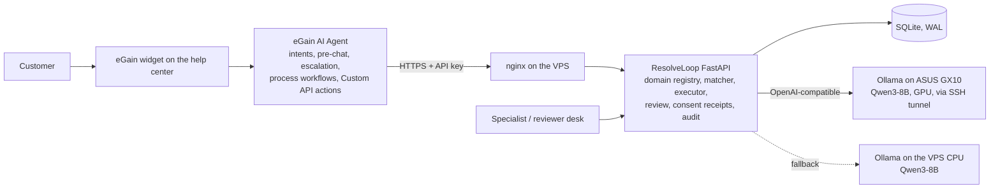

# ResolveLoop — human-to-AI support learning

Entry for the eGain hackathon **"Build, Demo, and Take Home a Working AI Support Bot"** (Devpost, Nov 2026). MIT licensed, see `LICENSE`. Demo video: https://youtu.be/zJ6LUtJvyqE

ResolveLoop is a learning layer behind an eGain AI Agent. When the agent escalates a problem it cannot solve,
a human specialist fixes it in a simulated support desk. The desk records the specialist's **structured tool
actions** (never screen pixels), proposes a **candidate playbook**, and a reviewer must **approve** it before it
can run. The next customer with the same problem in different words gets the approved fix applied, **verified**,
and audited. Ineligible or ambiguous cases are refused and escalated instead of guessed.

Demo domain: a fictional SaaS, **Orbit Analytics / Orbit Reports**, whose Cloud 2 migration silently drops the
per-user export permission. All data, accounts and contact details are synthetic (see `docs/domain.md`).

## Any domain, same loop (built)

Nothing in the loop is specific to SaaS exports. The domain lives in two plug-in points, and both are now data:

- **Domain registry** (`server/domains/`): `saas` = Orbit Reports (accounts C001..C016, export tools) and `telecom` =
  Nimbus Mobile (lines N001..N012, roaming tools). Each domain has its own published eGain agent on the same backend:
  Orbit Support Assistant and Nimbus Support Assistant (`egain/nimbus-blueprints.md`). Each domain declares its allowlisted tools with a **risk tier**
  (low / medium / high), its seed accounts and its entitlement and verification logic. The domain is resolved per request
  from a `domain` field, an `X-Domain` header, or the account-id prefix.
- **Content buckets** (`knowledge/manifest-<domain>.json`): every document is tagged *public* (the only bucket ever given
  to the eGain agent), *internal* (runbooks for specialists and for LLM drafting) or *restricted* (money, ownership,
  privacy: human only, never served), with source, owner, approver, date and version.
- **High-risk gate**: tools such as `billing.issue_credit` and `account.change_owner` can never be in a playbook or be
  called by an agent or a customer; a specialist needs consent plus a verified identity.
- **LLM-drafted procedures, human-graded**: when no playbook matches, `POST /v1/cases/{id}/draft` asks a local
  Qwen3-8B (Ollama, OpenAI-compatible; GX10 GPU box through an SSH tunnel with a CPU copy on the VPS as fallback) to draft
  one from the internal runbooks and the tool allowlist. The draft is validated (allowlist, one mutation, verifier, no
  high-risk tools), lands as `LLM_DRAFT`, and a reviewer approves it into `SUPERVISED`: it may run with consent, but each
  run must be confirmed by a reviewer; after three confirmed successes it becomes `APPROVED` on its own. If the model is
  unreachable, a deterministic draft from the best-matching runbook is produced and marked as such.

Swap the content pack and the tool module and the same agent, workflows and services serve telecom, healthcare,
ticketing, utilities or construction support. The business goal is headcount and budget: after a week or two of
learning on a real queue, routine cases resolve without a human and the team shrinks to the people who handle money,
ownership, privacy and genuinely new problems. That reduction is the design target, not a measured result; the measured
results are the 48 tests, the scored evaluation below and the live runs in `egain/OBSERVED.md` (a Qwen3-8B draft resolved and verified three Nimbus
lines under supervision and promoted itself, while suspended, un-upgraded and add-on-less lines were refused).

## Architecture, models and capacity



**Which model does what.** The customer-facing conversation (intent detection, grounded answers, deciding which action to
call and with which arguments) runs on eGain's hosted agent model; we configure it, we do not host it. ResolveLoop uses no
model for the critical path: the paraphrase matcher is deterministic concept overlap, prerequisites and verifiers are
plain tool calls, and every state change is an allowlisted tool. The only model ResolveLoop runs itself is **Qwen3-8B**
(Apache-2.0, 4-bit GGUF) served by **Ollama** (llama.cpp backend, not vLLM) and used for one offline job: drafting a
candidate playbook from internal runbooks, which a reviewer must still approve and which only becomes automatic after
supervised runs. The primary model host is an ASUS Ascent GX10 (NVIDIA GB10, 121 GB unified memory) reached through a
reverse SSH tunnel; the VPS keeps a CPU copy as fallback and `GET /v1/llm/health` reports which one is active.

**Measured on 2026-11-12** (Hostinger VPS, 8 vCPU, 31 GB, one uvicorn worker, SQLite):

| Load | Result |
|------|--------|
| 50 concurrent `GET /v1/accounts/{id}/status` | all 200, p95 0.53 s |
| 40 concurrent `POST /v1/resolve` (match + prerequisite checks) | all 200, p95 0.67 s, 0.72 s wall |
| 25 concurrent `POST /v1/tickets` | all 200 |
| Playbook drafting, GX10, 3 slots, 16k context | 3 parallel drafts in 48 s wall (31–48 s each), no JSON failures |
| Playbook drafting, VPS CPU fallback | 18 tokens/s, one draft at a time |

**Operational threshold.** We run the backend with a conservative limit of **25 concurrent agent sessions per instance**
(well inside the measured 40 simultaneous resolve calls) and **3 concurrent drafts** on the GPU box. Both are
configuration, not architecture: more sessions means more uvicorn workers behind nginx and SQLite replaced by Postgres;
more drafts means more Ollama slots or a vLLM deployment for batched decoding. Customer chat concurrency itself is handled
by eGain's platform, not by ResolveLoop. The first 25-way resolve run in the measurement session produced one 60-second
outlier that did not reproduce in three later runs; the nginx read timeout is set to 240 s so slow drafts never surface
as gateway errors.

**Plug-in domains.** A sector is a content pack (`knowledge/<domain>/`, three buckets, manifest) plus a tool module
(`server/domains/<domain>.py`: allowlisted tools with risk tiers, seed accounts, entitlement and verification logic).
Nothing else changes. Four sectors are registered and covered by end-to-end tests: `saas` (Orbit Reports, SaaS help desk),
`telecom` (Nimbus Mobile, mobile carrier), `ecommerce` (Harbor Goods, online retail and delivery: orders stuck after a
warehouse-system cutover, codes SH-100/200/300) and `ithelpdesk` (Northgate University IT, education: VPN access lost after an
SSO cutover, codes AC-100/200/300). Live eGain agents exist for the first two; the same loop applies to billing, networking or
infrastructure support.

## Measured quality: the scored evaluation

`eval/sectors.py` holds 172 labelled cases, 43 per sector, labelled by intent before the system was run: 16 paraphrases of
the sector's problem on eligible accounts, already-fixed accounts, every kind of ineligible account, a broken verifier
backend, 8 out-of-scope requests (refunds, address and owner changes, password resets, cancellations), 4 vague
one-word messages, 4 prompt injections and 3 messages from the other sectors. `python -m eval.run_eval` teaches each
sector once (one human fix, learn, approve), then runs every case on a freshly reset account set with confirm=false and
again with confirm=true, and writes `evidence/eval-report.md`. The same run is a release gate in
`tests/test_eval_gates.py`: the safety rows must be perfect, recall and resolution have a 90% floor.

Live run against the deployment on 2026-11-13 (own tenant, 565 calls, p95 368 ms; the in-process run gives the same rows):

| Metric | saas | telecom | ecommerce | ithelpdesk | All |
|---|---|---|---|---|---|
| Exact expected outcome | 100% | 100% | 100% | 97.7% | 99.4% |
| Match precision / recall | 100 / 100 | 100 / 100 | 100 / 100 | 100 / 95.8 | 100 / 99 |
| Eligible cases fixed and verified | 100% | 100% | 100% | 93.8% | 98.4% |
| Ineligible refused, already-fixed reported honestly | 100% | 100% | 100% | 100% | 100% |
| Broken backend caught by the verifier | 100% | 100% | 100% | 100% | 100% |
| Out-of-scope escalated, vague abstained, injections blocked | 100% | 100% | 100% | 100% | 100% |
| Cross-sector leakage, wrong actions, actions without consent | 0 | 0 | 0 | 0 | 0 |
| LLM draft (Qwen3-8B on the GX10) same steps and verifier as the human-taught playbook | yes, 23 s | yes, 23 s | yes, 22 s | yes, 25 s | 4 of 4 |

The one miss is on the safe side: "Duo passes but then the VPN kicks me out" names no symptom the sector vocabulary knows,
scores in the abstain band and goes to a specialist instead of being guessed.

How the set was used, in order. The first run (156 cases) scored 89% with two wrong actions and found three real defects:
a learned saas playbook had frozen `role == analyst` from its one example and refused entitled admins; a one-utterance
playbook generalised poorly (telecom recall 50%), so learned playbooks are now seeded with the runbook's canonical
phrasings; and "Export button spins forever since the migration" on an order re-queued dispatch because the two only
shared "stuck" and "migration", so a match now needs a shared specific concept and a symptom in the message. That took
the set to 97.4% with four safe misses. Recall was then improved by giving each domain plug-in a reviewer-editable
`vocabulary` (sector words to concepts: "internet" and "4G" to data, "landed" and country names to abroad, "AnyConnect"
to VPN, "rejected" to a symptom), and 16 new paraphrases were written and labelled *before* that change was run, as a
held-out check. Fifteen of the sixteen matched.

## Layout

| Path | What |
|------|------|
| `server/` | FastAPI orchestrator: `domains` (registry: saas, telecom, risk tiers), `content` (bucket manifests), `drafting` (LLM client + validator + fallback), `mock_business` (synthetic accounts + allowlisted tools), `trace` (action events, audit), `learning` (deterministic trace → playbook extractor), `review` (approval state machine, versioning), `resolve` (paraphrase matcher, gated executor, verifier) |
| `web/` | Simulated support desk (dashboard with live metrics, customer simulator, human desk, reviewer, audit) and the Orbit help center page the eGain widget sits on (static, served at `/ui/`) |
| `tests/` | pytest (47): E2E-01…06, safety/negative cases, paraphrase set, telecom domain loop, content buckets, LLM drafting and supervised promotion |
| `knowledge/` | Fictional help content per domain: `src/` + `pdf/` (Orbit public), `telecom/` (Nimbus public, internal, restricted), `saas/internal|restricted`, and the bucket manifests |
| `egain/` | Workflow blueprints for the eGain console (pre-chat, escalation, process tools, action) and reviewer instructions |
| `contracts/openapi.json` | API contract exported from the app |
| `deploy/` | systemd unit, nginx location, VPS deploy script |
| `docs/` | Domain definition, demo script, submission text |

## Run locally

```bash
python3 -m venv .venv && .venv/bin/pip install fastapi "uvicorn[standard]" pydantic httpx pytest
RESOLVELOOP_API_KEY=demo-key .venv/bin/uvicorn server.main:app --port 8790 --reload
```

Open http://127.0.0.1:8790/ui/ and enter `demo-key` in the settings strip. API docs: http://127.0.0.1:8790/docs.

Tests (writes `evidence/junit.xml`):

```bash
.venv/bin/python -m pytest -q -s tests --junitxml=evidence/junit.xml
```

## The loop in five calls

1. `POST /v1/resolve` with a new problem → `NO_PLAYBOOK`, escalation options (nothing is mutated).
2. Specialist in the desk: `accounts.get_profile` → `accounts.check_entitlement` → `accounts.grant_export_permission` (consent) → `reports.test_export`; each call becomes an `ActionEvent`.
3. `POST /v1/cases/{id}/learn` → `202 REVIEW_PENDING` candidate with prerequisites, steps, verifier, provenance.
4. `POST /v1/playbooks/{id}/approve` → `APPROVED` (identity and time recorded).
5. `POST /v1/resolve` with a paraphrase → `CONFIRM_REQUIRED`, then with `confirm=true` → `RESOLVED` with `verified: true`; an inactive account gets `PRECONDITION_FAILED` and escalation.

State machines: Case `NEW → AGENT_ATTEMPTED → ESCALATED → HUMAN_WORKING → HUMAN_RESOLVED → CLOSED` (alt. `NEEDS_HUMAN`, `FAILED_VERIFICATION`);
Playbook `REVIEW_PENDING → APPROVED → RETIRED` (`REJECTED` terminal); Execution `PROPOSED → AUTHORIZED → RUNNING → VERIFYING → SUCCEEDED` (alt. `BLOCKED`, `FAILED`).

## Known limitations (honest list)

- The human-trace extractor is deterministic (`deterministic-v1`) and generalizes nothing on its own; LLM drafts come from an 8B model reading internal runbooks and are gated by review and supervised runs: prerequisites are the observed state, and a reviewer widens them (e.g. role analyst → analyst or admin) through a new version.
- Paraphrase matching is concept-overlap over reviewer-editable examples, not embeddings. Measured on the bundled set: see the test output.
- Actions are captured only at the mock tool boundary of one simulated desk. No desktop or screen observation.
- The eGain integration depth depends on what the hackathon tenant exposes; `egain/OBSERVED.md` records what was actually observed working: three Custom API actions (resolve export issue, check account status, open ticket), three process/escalation workflows that call the API node (export troubleshooter, subscription check, escalation with ticket and callback), branded widget.
- Tickets and callbacks are stored in ResolveLoop only; no email or telephony is sent (the eGain Send Email and Trigger Call connectors are configured with fictional contacts).
- Every confirmed execution carries a **consent receipt** (the customer's exact words, time, channel, session, principal) and
  `GET /v1/executions/{id}/receipt` returns it with the trace it authorized, the playbook version and the audit entries, so a
  dispute can be answered from the record. eGain keeps the chat transcript on its side.
- Prototype security only: a shared API key, synthetic identities, no SSO. Customers are identified by the line or account id
  they type in pre-chat; a verification step (PIN or one-time code) before any fix is the obvious next step and is not built. The eGain Custom API action lets the
  agent fill `account_id` from the conversation, so a customer can name another synthetic account; ResolveLoop only
  enforces the owner check when `principal_id` is supplied (the process workflow uses the pre-chat `accountId`).

## Disclosure

Built with FastAPI, Uvicorn, Pydantic, httpx, pytest, ReportLab and Python-Markdown. Generative AI coding tools were used
to write code and documentation. All knowledge content is original and fictional. MIT license.
